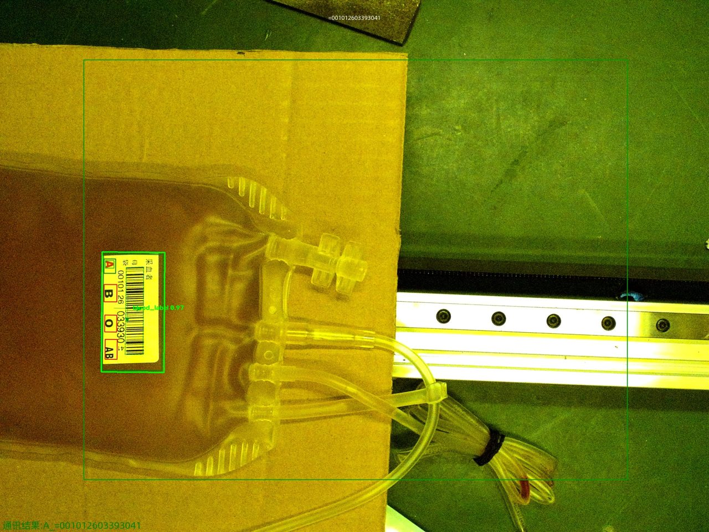

# yolo_Blood — Blood Bag Label Detection & Type Classification

[](LICENSE)
[](https://www.python.org/)
[](https://pytorch.org/)
[](https://docs.ultralytics.com/models/yolo11/)
[](https://www.rock-chips.com/)
[](docs/rkopt-int8-guide.md)

English | [简体中文](README.md)

YOLO11-OBB based oriented bounding box detection of blood bag labels plus blood bag type classification (red blood cell / plasma), covering the full pipeline: **automatic labeling → training → RKNN INT8 quantization → on-device deployment on RK3576**, reaching **30–39 FPS** on the board.



## ✨ Highlights

- **OBB detection** — blood bags are always tilted on the line; horizontal boxes would include too much background and hurt downstream OCR, so we use oriented bounding boxes that fit the label sticker precisely.
- **Automatic labeling pipeline** — raw data ships with manually annotated render images; `cv2.absdiff` + contour analysis extracts OBB coordinates automatically across 719 image pairs, no manual labeling needed.
- **RKOPT INT8 quantization** — uses the airockchip RKOPT export (Sigmoid/DFL removed from the graph), which fixes the well-known "all-zero conf" RKNN int8 failure and gives a **2.4× speedup** (13 FPS → 30–39 FPS) on the RK3576 NPU.
- **On-device web service** — Flask live video stream + detection API + HD snapshot, kept alive by supervisor.

## 📐 Components

| Sub-project | Directory | Task | Model |
|-------------|-----------|------|-------|
| Label detection | `src/blood_label/` | Detect label stickers with OBB | YOLO11n-OBB |
| Type classification | `src/blood_classify/` | Red blood cell vs. plasma | YOLO11n-cls |

Detection metrics (yolo11n-obb, epoch 98): **mAP@50 0.9691**, Precision 1.000, Recall 0.995.

## 🚀 Quick Start

```bash
git clone https://github.com/HaoQianCheng/yolo_Blood.git
cd yolo_Blood
python -m venv .venv && source .venv/bin/activate
pip install -r requirements.txt

# 1. automatic labeling from origin/render image pairs
cd src/blood_label
python extract_labels.py --raw data/raw
python split_dataset.py --raw data/raw --output data/datasets/blood_label

# 2. training
python train.py --epochs 100 --batch 16 --imgsz 640 --device 0

# 3. RKOPT ONNX export + INT8 quantization (Linux/WSL, rknn-toolkit2)
#    see docs/rkopt-int8-guide.md
cd ../../scripts/quant
python convert_int8.py <best.onnx> <calib_dir> <out_dir> --target rk3576

# 4. deploy to RK3576
#    see docs/deployment-rk3576.md
cd ../../src/blood_label/rknn
python3 infer.py --cam
```

## 📚 Documentation (Chinese)

- [RKOPT INT8 quantization guide](docs/rkopt-int8-guide.md) — comparison of 4 quantization schemes, export details, on-board benchmarks
- [RK3576 deployment guide](docs/deployment-rk3576.md) — board setup, model upload, supervisor service
- [Training guide](docs/training-guide.md) — data pipeline, training parameters, metrics
- [RKNN init troubleshooting](docs/troubleshooting-rknn-init.md) — debugging notes for RKNN init error -7

## 📄 License

[MIT License](LICENSE) © HaoQianCheng
